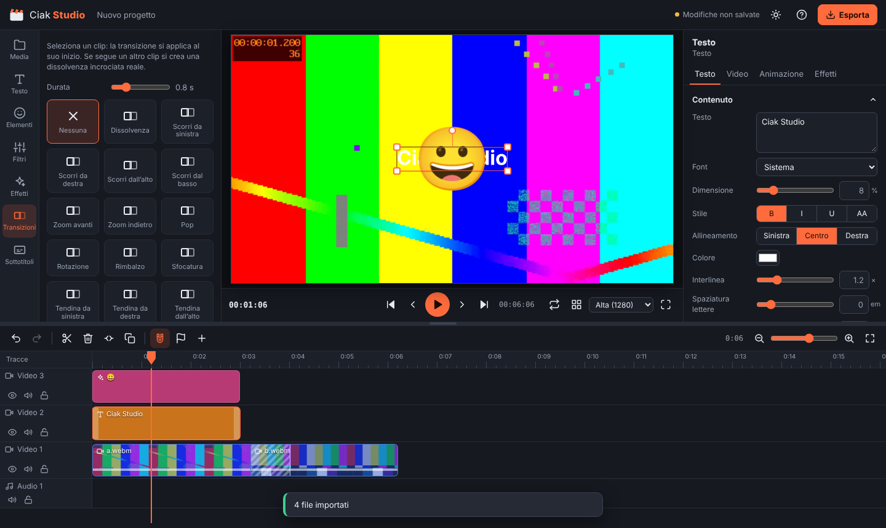

# 🎬 Ciak Studio

**Editor video non lineare open source che funziona nel browser.** Niente installazione, niente account,
niente upload: i tuoi file restano sul tuo computer.

Ispirato alla semplicità di CapCut, costruito su un nucleo di montaggio verificato da test automatici.



## Avvio rapido

**Opzione A — file unico (consigliata per usarlo):**

```bash
npm install
npm run build        # crea dist/ciak-studio.html (≈ 215 KB, tutto incluso)
```

Apri `dist/ciak-studio.html` con **doppio clic** in Chrome, Edge o Firefox. Funziona offline.

**Opzione B — sviluppo:**

```bash
npm start            # http://localhost:5173  (server statico senza dipendenze)
```

Serve un browser recente con `MediaRecorder` e WebAudio. **Testato solo su Chromium (Chrome/Edge)**:
con Firefox e Safari non l'ho provato. Il codice prevede dei fallback (ad esempio un filtro colore software
per i browser senza `ctx.filter`, e la scelta automatica del formato di esportazione supportato), ma non
sono verificati su quei browser.

## Cosa sa fare

**Montaggio**
- Tracce video e audio illimitate: blocca, nascondi, silenzia, rinomina, riordina
- Taglia (`S`), elimina, elimina e chiudi lo spazio, duplica, copia/taglia/incolla, selezione multipla
- Trascina e ritaglia i clip con **calamita** (bordi, testina, marcatori), spostamento fra tracce, scorrimento
  automatico ai bordi, zoom con Ctrl+rotella, marcatori
- Annulla/ripeti a 100 livelli (un trascinamento = un solo passo)
- **Velocità** 0,1×–8×, **fotogramma fisso**, **estrai audio**, copia di un clip

**Transizioni, animazioni, keyframe**
- Oltre 20 transizioni: dissolvenza, scorrimenti, tendine, iride, zoom, rotazione, flash, dissolvenza nel nero…
  Fra due clip adiacenti creano una **vera dissolvenza incrociata** (i clip si sovrappongono, audio incluso)
- Animazioni di ingresso e di uscita su qualsiasi clip
- **Keyframe** su posizione, scala, rotazione, opacità e volume, con 5 tipi di interpolazione

**Aspetto**
- Formati 16:9 · 9:16 · 1:1 · 4:5 · 4:3 · 3:4 · 21:9, da 24 a 60 fps
- Scala, posizione, rotazione, opacità, ribalta, ritaglio; maniglie direttamente sul video con guide di centratura
- 11 metodi di fusione, 6 maschere (anche invertite)
- 14 filtri con intensità; luminosità, contrasto, saturazione, tonalità, temperatura, tinta, sfocatura,
  vignettatura, grana
- 11 effetti: tremore, pulsazione, sfocatura, bagliore, mosaico, separazione RGB, glitch, specchio, VHS,
  grana pellicola, stroboscopio
- **Chroma key** (schermo verde), **livelli di regolazione** che agiscono su tutto ciò che sta sotto

**Testo e grafica**
- Testo con 8 stili pronti, font di sistema o **caricati da te**, contorno, ombra, sfondo, animazione «macchina da scrivere»
- Oltre 100 adesivi emoji, 8 forme, sfondi colorati
- **Sottotitoli**: importa/esporta `.srt`, lista modificabile, 4 stili

**Audio**
- Volume fino al 200% con keyframe, dissolvenze, forma d'onda, silenzia clip o traccia
- **Registrazione della voce** direttamente sulla timeline (voice-over)
- Limiter integrato: niente distorsione quando si sommano più sorgenti

**Importazione, esportazione, progetto**
- Importa video, audio e immagini (i formati letti dal browser) anche con trascinamento
- Esporta **WebM** (o **MP4** dove il browser lo supporta), 480p–1080p, 4 livelli di qualità; fotogramma PNG; sottotitoli SRT
- **Salvataggio automatico** nel browser con ripristino alla riapertura
- Pacchetto **`.ciak`** (progetto + media) per spostare il lavoro su un altro computer

## Scorciatoie

`Spazio` riproduci · `←/→` fotogramma (con `Maiusc` 1 s) · `↑/↓` taglio precedente/successivo · `S` dividi ·
`Canc` elimina (`Maiusc+Canc` chiude lo spazio) · `Ctrl+Z / Maiusc+Z` annulla/ripeti · `Ctrl+C/X/V/D` copia/taglia/incolla/duplica ·
`M` marcatore · `N` calamita · `+/−` zoom · `\` adatta · `F` schermo intero · `Ctrl+E` esporta · `?` guida completa

## Cosa NON c'è (e perché)

Meglio dirlo chiaramente:

- **Nessuna IA**: niente sottotitoli automatici, rimozione sfondo, stabilizzazione o ritocco del volto.
  L'editor lavora offline e senza servizi esterni; i sottotitoli si importano da `.srt`.
- **Niente riproduzione inversa** né curve di velocità (c'è la velocità costante).
- **L'esportazione è in tempo reale**: un video da 1 minuto richiede circa 1 minuto e la scheda deve restare
  visibile. È il prezzo di avere esattamente ciò che vedi in anteprima, con le API standard del browser. Al
  termine l'editor ti dice quanti fotogrammi sono stati prodotti e ti avvisa se il computer non ha tenuto il passo.
- **Codec**: MP4/H.264 in esportazione dipende dal browser (nel Chromium usato per i test si ottiene WebM VP9).
  Anche quali file si possono importare dipende dal browser.
- I **font caricati** valgono per la sessione (non sono salvati nel progetto).
- Non è un sostituto di DaVinci Resolve o Premiere: niente correzione colore a curve/LUT, multicam, proxy per 4K+.

## Affidabilità: cosa è stato verificato

«Senza bug» non si può dimostrare; si può testare molto. Cosa viene eseguito davvero:

- **Fuzzing del montaggio**: centinaia di migliaia di operazioni casuali (aggiungi, sposta, ritaglia, dividi,
  velocità, transizioni, ripple, incolla, fotogramma fisso, blocco tracce…). Dopo ognuna il progetto deve restare
  valido e undo/redo devono riportare **esattamente** allo stato precedente. Ha già scovato bug reali.
- **Test nel browser vero (Chromium)** con media generati da ffmpeg: importazione, riproduzione con
  sincronizzazione A/V misurata, mouse e tastiera, **lettura dei pixel dell'anteprima** (filtri, chroma key,
  transizioni, keyframe, maschere), ripristino dopo il ricaricamento, drag & drop, tema, layout da 560 a 1920 px.
- **L'esportazione viene verificata con strumenti esterni**: `ffprobe` (durata, risoluzione, tracce),
  `ffmpeg` (decodifica senza errori, volume audio, contenuto del fotogramma); il pacchetto `.ciak` con `zipfile` di Python.
- Ogni test E2E fallisce se compare un errore in console.

```bash
npm test             # unitari + fuzzing (secondi)
npm run test:e2e     # Chromium reale + ffmpeg (alcuni minuti; serve ffmpeg e il Chromium di Playwright)
npm run bench        # prestazioni sulla tua macchina
FUZZ_SEEDS=800 FUZZ_STEPS=300 npm test    # campagna di fuzzing estesa
```

## Prestazioni

Misure su Chromium *headless con rendering software* (nessuna GPU): su un computer reale con GPU sono migliori.

| Caso | Misura |
| --- | --- |
| Operazione di montaggio con 2000 clip su 20 tracce | ≈ 12 ms (sotto 1 ms nei progetti normali) |
| Un livello immagine con filtro/effetti statici, 720p | ≈ 0,4 ms (cache dell'aspetto) |
| Chroma key su immagine, 720p | 12 ms → 0,4 ms con la cache |
| Caso estremo: 7 livelli con grana, vignetta, glitch, VHS… impilati | ≈ 73 ms a 720p (peggiore scenario) |
| Esportazione 480p/30 fps di 3 s | 89 fotogrammi su 90 |

Le ottimizzazioni principali: strato offscreen solo se serve, cache dell'aspetto statico dei clip immagine,
glow a risoluzione ridotta, riconciliazione del DOM della timeline per chiave, esportazione pilotata da un
timer invece che dal refresh della pagina.

## Struttura

Vedi [`docs/ARCHITETTURA.md`](docs/ARCHITETTURA.md). In breve: `src/core` (logica pura e testabile),
`src/engine` (rendering, audio, riproduzione, esportazione), `src/ui` (interfaccia senza framework).

## Contribuire

Le modifiche al modello partono da `src/core` con il loro test; se toccano la timeline, aggiungi l'operazione
al fuzzer. Segnala bug riproducibili con il file `.ciak` del progetto, se possibile.

## Licenza

MIT — vedi [`LICENSE`](LICENSE).
